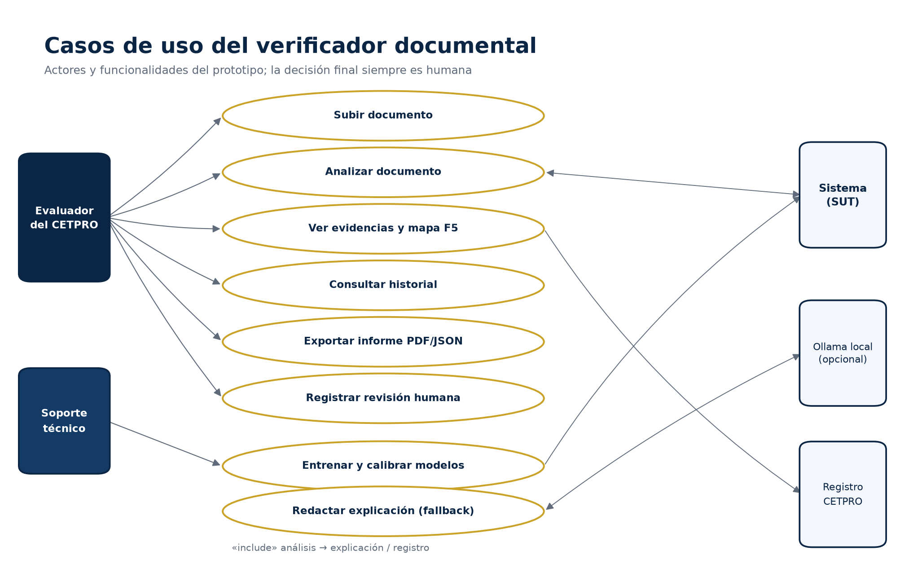
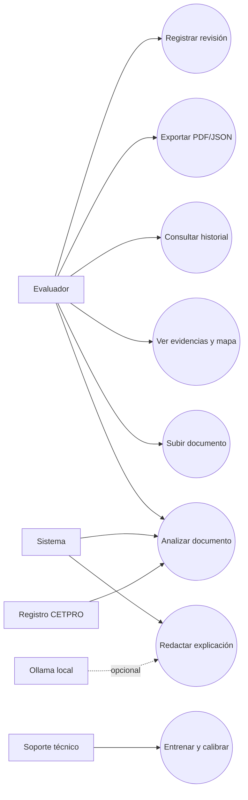
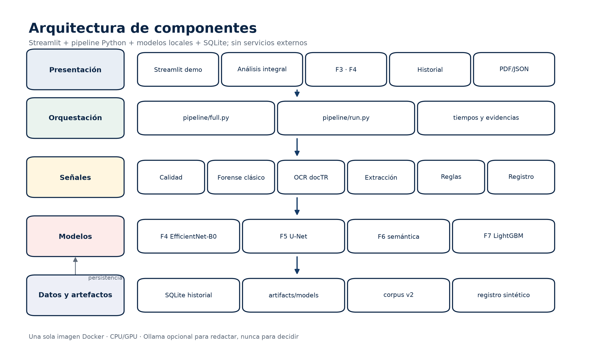
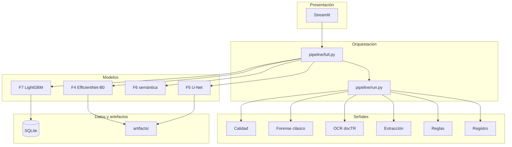
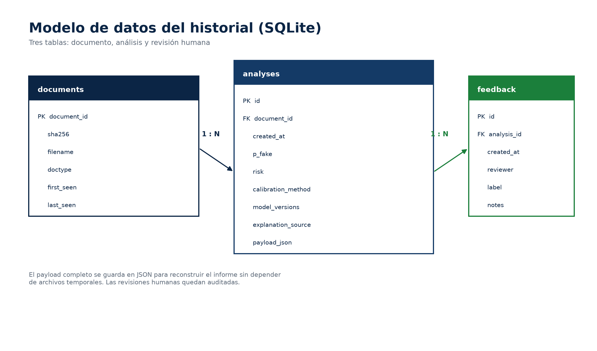
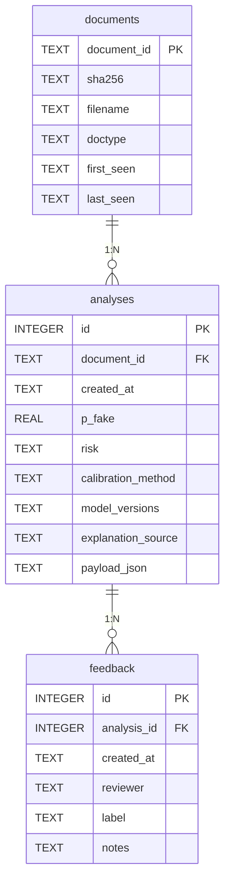
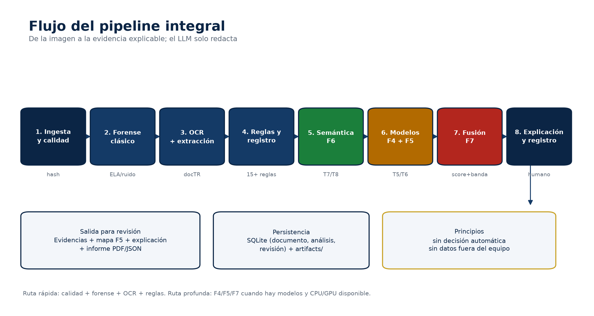
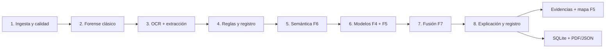
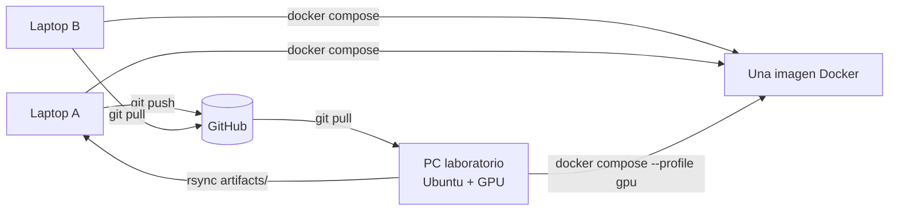

# Diagramas del sistema

Diagramas para la sustentación y el Cap. IV. Las versiones PNG están en
`docs/figuras/` y se regeneran con:

```bash
make diagrams
```

## 1. Casos de uso



Actores: **Evaluador del CETPRO** (consulta, analiza, exporta y registra la
revisión), **Soporte técnico** (entrena y calibra), **Sistema** (orquesta el
pipeline), **Ollama local** (solo redacta; opcional) y **Registro CETPRO**
(espejo sintético para el cruce). La decisión final es siempre humana.



## 2. Arquitectura de componentes



Una sola imagen Docker. Streamlit orquesta; el pipeline ejecuta calidad,
forense, OCR, extracción, reglas, registro, F6 semántica, F4, F5 y F7. SQLite
guarda el historial; `artifacts/` conserva checkpoints y mapas. Ollama es
opcional y nunca participa en la decisión.



## 3. Modelo de datos (SQLite)





El payload completo del análisis se guarda como JSON para reconstruir el
informe. `feedback` registra la revisión humana: el sistema no decide solo.

## 4. Flujo del pipeline





La ruta rápida (calidad + forense + OCR + reglas) está siempre disponible. La
ruta profunda (F4/F5/F7) se usa cuando los checkpoints existen; si faltan, el
sistema muestra las señales base y lo declara.

## 5. Despliegue (3 PCs, un entorno)



Los datos y artefactos no viajan por git: `data/` y `artifacts/` están
ignorados. Los documentos del CETPRO, si existieran, se sincronizarían aparte.
