# Diagramas del sistema

Paquete de diagramas para la sustentación y el Cap. IV. Las imágenes están en
`docs/figuras/` y se regeneran con:

```bash
make diagrams
```

El script `scripts/diagrams.py` genera todas las imágenes. La tabla de casos de
prueba se calcula con `pytest --collect-only`.

## Índice de imágenes

| Imagen | Qué muestra |
|---|---|
| [`casos_uso.png`](figuras/casos_uso.png) | Casos de uso y actores |
| [`casos_uso_tabla.png`](figuras/casos_uso_tabla.png) | Detalle actor → caso → resultado |
| [`modulos.png`](figuras/modulos.png) | Paquetes reales y dependencias |
| [`clases.png`](figuras/clases.png) | Contrato `Observation` y clases del pipeline |
| [`secuencia_analisis.png`](figuras/secuencia_analisis.png) | Secuencia de un análisis |
| [`estados_riesgo.png`](figuras/estados_riesgo.png) | Calidad, bandas y revisión humana |
| [`arquitectura.png`](figuras/arquitectura.png) | Componentes y capas |
| [`despliegue.png`](figuras/despliegue.png) | 3 PCs, Docker, git y rsync |
| [`base_datos_fisica.png`](figuras/base_datos_fisica.png) | Esquema SQLite con tipos, PK/FK e índices |
| [`base_datos_datos.png`](figuras/base_datos_datos.png) | Filas reales de `artifacts/history.db` |
| [`er_historial.png`](figuras/er_historial.png) | Modelo entidad-relación |
| [`flujo_pipeline.png`](figuras/flujo_pipeline.png) | Flujo F3→F7 |
| [`casos_prueba.png`](figuras/casos_prueba.png) | Matriz de 256 casos de prueba |

## 1. Casos de uso


Actores: **Evaluador del CETPRO** (consulta, analiza, exporta y registra la
revisión), **Soporte técnico** (entrena y calibra), **Sistema** (orquesta el
pipeline), **Ollama local** (solo redacta; opcional) y **Registro CETPRO**
(espejo sintético para el cruce). La decisión final es siempre humana.

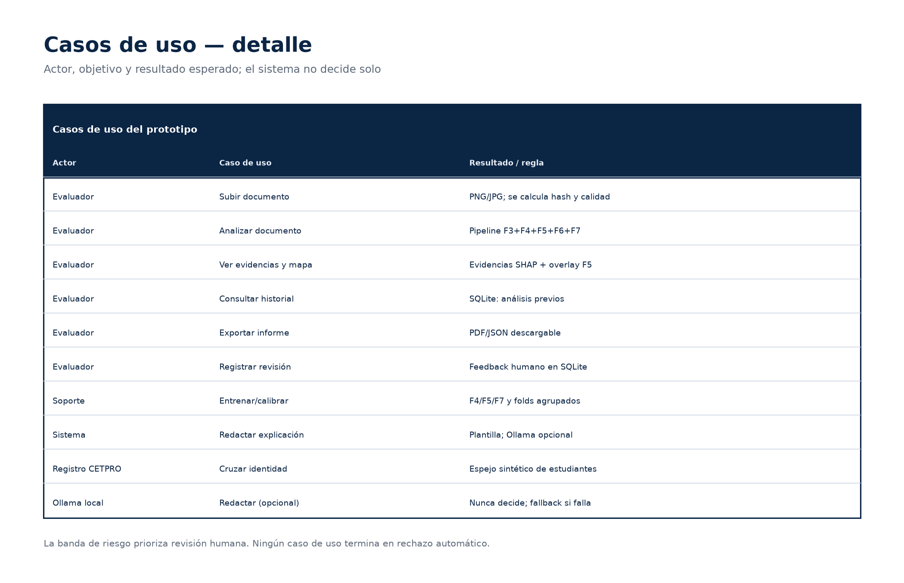

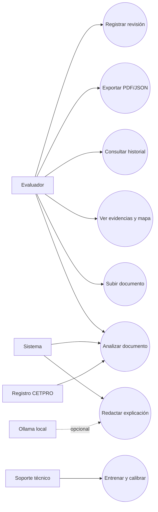

## 2. Módulos

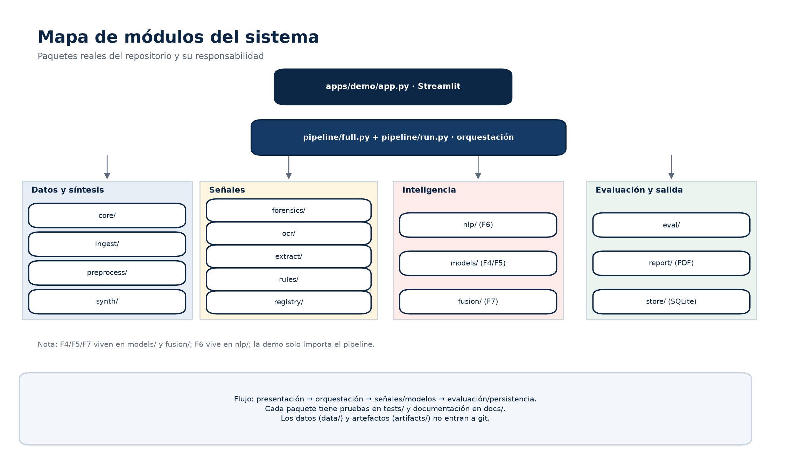

El detalle por paquete está en [`modulos.md`](modulos.md). En resumen:

- **Datos y síntesis:** `core/`, `ingest/`, `preprocess/`, `synth/`.
- **Señales:** `forensics/`, `ocr/`, `extract/`, `rules/`, `registry/`.
- **Inteligencia:** `nlp/` (F6), `models/` (F4/F5), `fusion/` (F7).
- **Evaluación y salida:** `eval/`, `report/` (PDF), `store/` (SQLite).
- **Presentación y orquestación:** `apps/demo/`, `pipeline/`.

## 3. Clases del contrato de datos

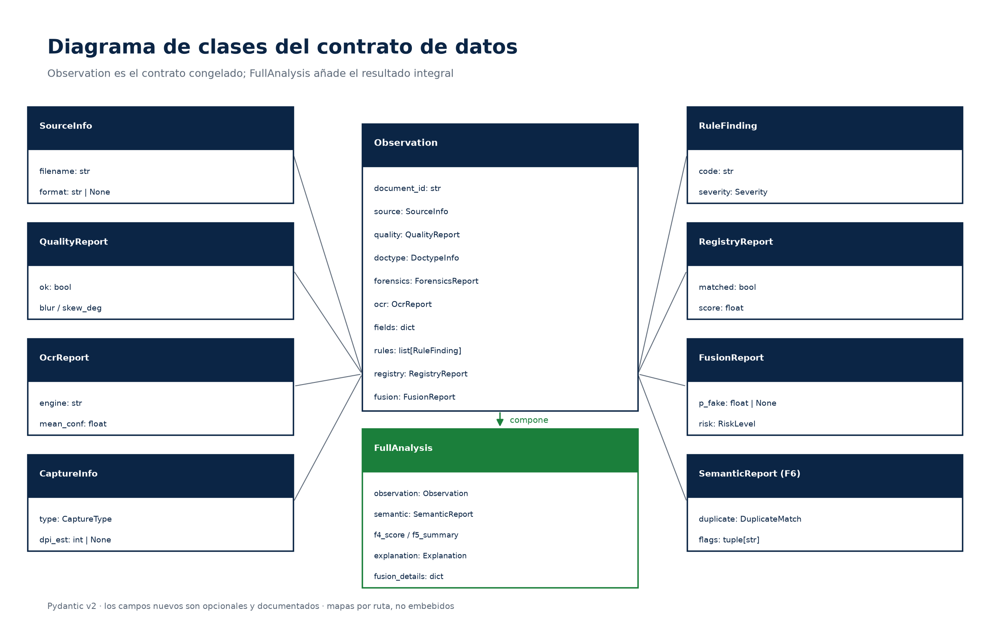

`Observation` es el contrato congelado entre módulos. `FullAnalysis` envuelve la
observación, la semántica, los scores F4/F5, la explicación y el detalle de F7.
Los mapas se referencian por ruta; no se embeben en el JSON.

## 4. Secuencia de análisis

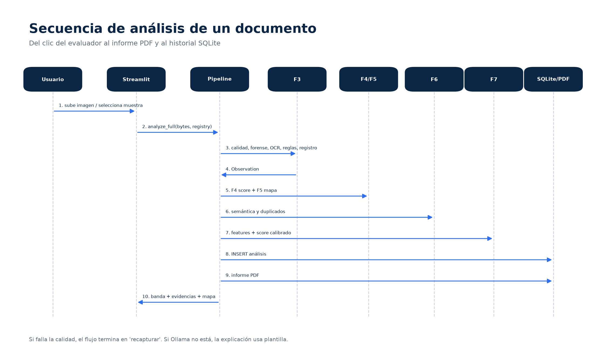

1. El usuario sube una imagen o elige una muestra.
2. Streamlit llama a `pipeline/full.analyze_full`.
3. F3 ejecuta calidad, forense, OCR, extracción, reglas y registro.
4. F4 y F5 calculan score de página y mapa de localización.
5. F6 calcula semántica y duplicados.
6. F7 construye las 62 features, aplica el modelo y la calibración.
7. Se guarda el análisis en SQLite y se genera el PDF.
8. Streamlit muestra banda, evidencias, mapa y explicación.

Si la calidad falla, el flujo termina en "recapturar". Si Ollama no responde,
la explicación usa la plantilla.

## 5. Estados y bandas

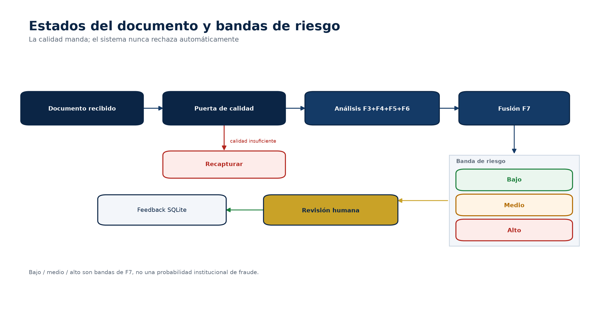

La puerta de calidad manda. Un documento ilegible no se marca como fraude:
se pide recapturar. Los documentos analizables pasan a F7 y reciben una banda
(bajo/medio/alto). La revisión humana se registra en SQLite. Ningún estado
termina en rechazo automático.

## 6. Arquitectura y despliegue


Una sola imagen Docker. Streamlit orquesta; el pipeline ejecuta las capas; los
modelos viven en `artifacts/`; SQLite guarda el historial. Ollama es opcional y
nunca decide.

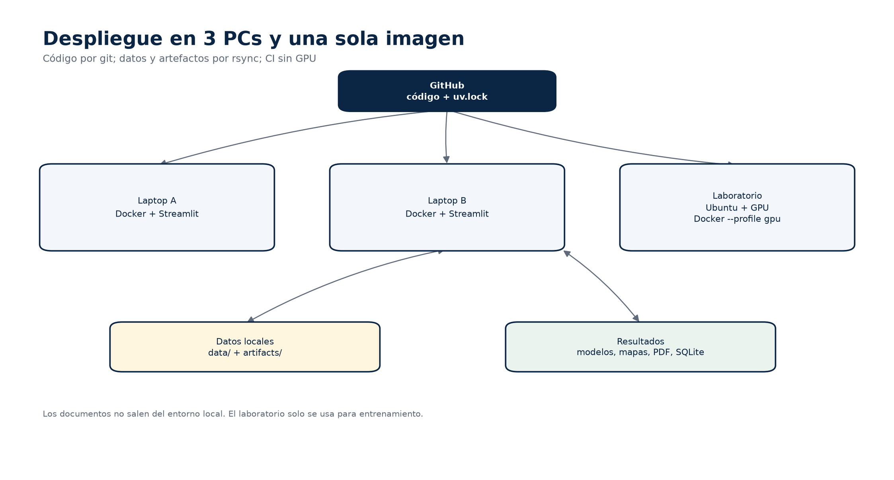

- Código por **git**; datos y artefactos por **rsync**.
- La PC del laboratorio (Ubuntu + GPU) se usa por SSH/tmux para entrenar.
- El CI corre en CPU; no requiere GPU.
- Los documentos no salen del entorno local.

## 7. Base de datos

El profesor pide la base de datos: **sí existe**. Es SQLite, en
`artifacts/history.db`, con tres tablas:

| Tabla | Para qué |
|---|---|
| `documents` | Documento, hash, nombre, tipo y fechas |
| `analyses` | Resultado, score, banda, calibración, versiones y payload JSON |
| `feedback` | Revisión humana: revisor, etiqueta y notas |

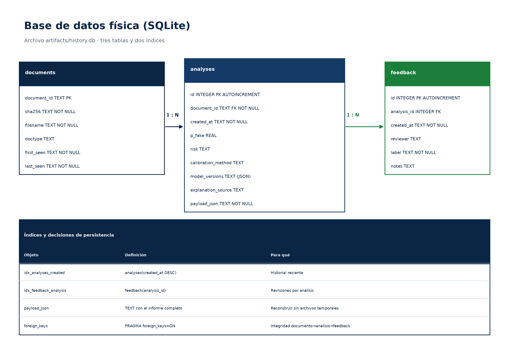

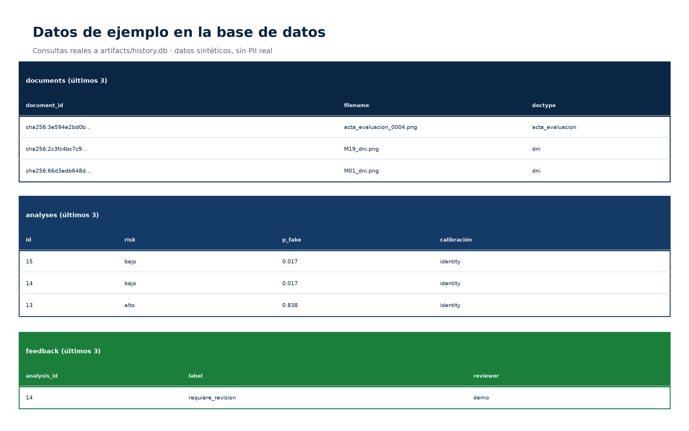


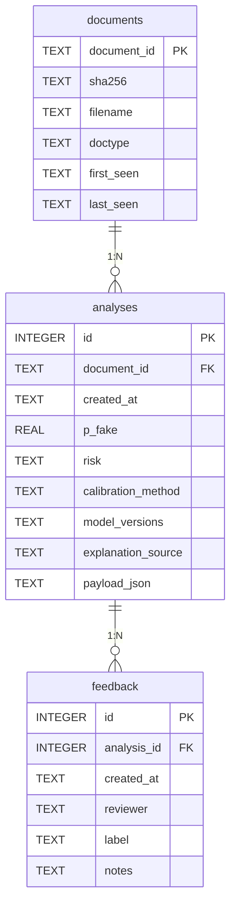

El payload completo del análisis se guarda como JSON para reconstruir el
informe. `feedback` registra la revisión: el sistema no decide solo.

## 8. Flujo del pipeline


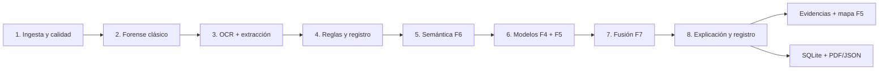

La ruta rápida (calidad + forense + OCR + reglas) está siempre disponible. La
ruta profunda (F4/F5/F7) se usa cuando los checkpoints existen; si faltan, el
sistema muestra las señales base y lo declara.

## 9. Casos de prueba

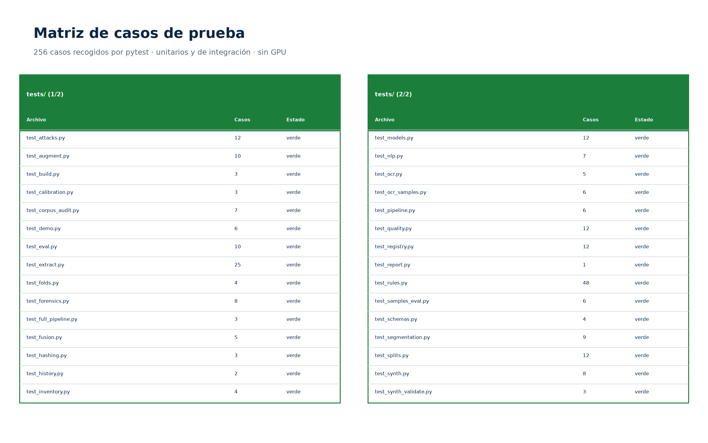

**256 casos** recogidos por pytest, sin GPU. La matriz se genera leyendo
`pytest --collect-only`; los archivos siguen el nombre del módulo. El detalle
de módulos y pruebas está en [`modulos.md`](modulos.md).
